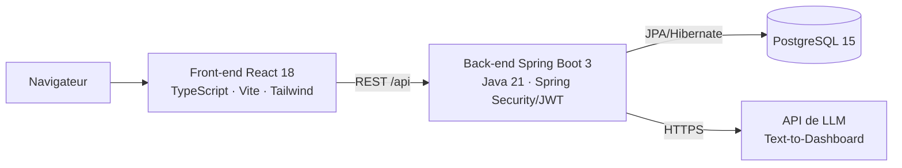

# ERP Achats & BI

[](https://github.com/mohamed5mehdi/ERP-Achats-BI/actions/workflows/ci.yml)


Progiciel de gestion des **achats, des stocks, des transferts inter-dépôts et des budgets**, avec un module BI piloté en langage naturel et un assistant conversationnel.
Projet de fin d'études d'ingénieur (EMSI), réalisé chez **Bugshan Automotive Group** (avril – juillet 2026) en Scrum, sur 4 sprints.

> Les données de démonstration chargées au démarrage sont fictives.

---

## Fonctionnalités

**Achats & workflow**
- Demandes d'achat internes, bons de commande, réceptions (GRN), factures et avoirs
- Workflow de validation hiérarchique à **5 niveaux** (N+1 → technique → AMG → DAF → DG), avec routage selon le montant
- Gouvernance budgétaire préventive : budget réservé dès la valorisation (verrous de type escrow), blocage automatique en cas de dépassement
- Circuit accéléré pour les pièces de rechange SAV
- Génération des documents PDF (bons de commande, réceptions)

**Stocks & logistique**
- Suivi multi-entrepôts et transferts inter-dépôts (sortie, transit, réception)

**IA & BI**
- **Text-to-Dashboard** : une question en langage naturel est traduite en requête SQL par une API de LLM, puis affichée en graphiques. La requête générée passe par un garde-fou : `SELECT` / `WITH` uniquement, verbes DML et requêtes empilées rejetés.
- **Assistant conversationnel** (NLP, slot-filling, fuzzy matching) pour saisir une demande d'achat en langage naturel, avec confirmation explicite avant création
- **Détection d'anomalies** sur les montants par Z-score (|z| > 2 suspect, |z| > 3 critique)

**Sécurité**
- Authentification JWT (Spring Security), contrôle d'accès par rôle au niveau des méthodes (`@PreAuthorize`)
- Secrets externalisés en variables d'environnement

---

## Architecture



Monolithe modulaire : chaque domaine (achats, stocks, transferts, budget, chatbot, IA) est un module avec ses contrôleurs, services et dépôts. Le tout est conteneurisé avec Docker Compose.

---

## Démarrage rapide (Docker)

Prérequis : Docker et Docker Compose. Aucune installation de Java, Node ou PostgreSQL n'est nécessaire.

```bash
git clone https://github.com/mohamed5mehdi/ERP-Achats-BI.git
cd ERP-Achats-BI
cp .env.example .env        # renseigner DB_PASSWORD et JWT_SECRET
docker compose up --build
```

| Service | URL |
|---|---|
| Application (front-end) | http://localhost:3000 |
| API (back-end) | http://localhost:8090/api |

**Comptes de démonstration** (mot de passe : `password`) : `demandeur@test.com`, `n1@test.com`, `acheteur@test.com`, `magasinier@test.com`, `daf@test.com`, `dg@test.com`, `admin@test.com`.

Le module Text-to-Dashboard nécessite une clé d'API (`GEMINI_API_KEY` dans `.env`) ; le reste de l'application fonctionne sans.

## Développement local

```bash
docker compose up db                      # base PostgreSQL seule
# Back-end (port 8090) : variables DB_USERNAME, DB_PASSWORD, JWT_SECRET requises
./mvnw spring-boot:run
# Front-end (port 3005, proxy /api → 8090)
cd frontend && npm install && npm run dev
```

## Tests

```bash
./mvnw verify -Dspring.profiles.active=test
```

128 tests (unitaires et d'intégration Spring Boot), exécutés à chaque push par GitHub Actions sur une base PostgreSQL éphémère.

---

## Stack

| Couche | Technologies |
|---|---|
| Back-end | Java 21, Spring Boot 3.4, Spring Security (JWT), Spring Data JPA / Hibernate |
| Front-end | React 18, TypeScript, Vite, Tailwind CSS, TanStack Query, Recharts |
| Données | PostgreSQL 15 |
| DevOps | Docker, Docker Compose, GitHub Actions, Qodana |

## Auteur

**Mohamed Mehdi El Jadaoui** — ingénieur logiciel
[LinkedIn](https://www.linkedin.com/in/mehdi-el-jadaoui-2a7755407) · [GitHub](https://github.com/mohamed5mehdi)
